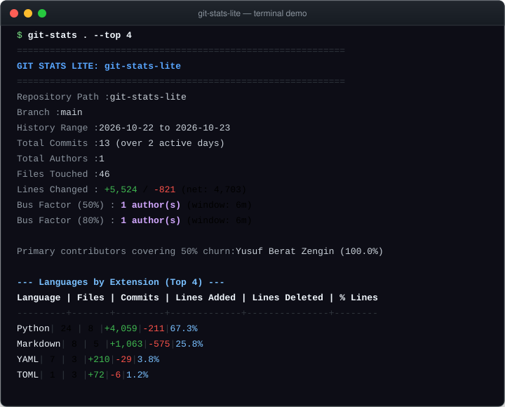

# git-stats-lite

[](https://github.com/YusufBeratZengin/git-stats-lite/actions/workflows/ci.yml)
[](https://pypi.org/project/git-stats-lite/)
[](https://pypi.org/project/git-stats-lite/)
[](LICENSE)
[](pyproject.toml)

> Yerel Git geçmişinden hızlı, gizlilik odaklı istatistikler ve bus factor risk analizleri.

[English](README.md) | [Türkçe](README.tr.md)

## Demo

<p align="center">
  
</p>

## Why git-stats-lite?

- **Sıfır çalışma zamanı bağımlılığı ve %100 çevrimdışı**: Tamamen yerel Git kopyanız üzerinde alt süreç akışıyla (subprocess streaming) çalışır. Ağ çağrısı, bulut servisi, izleme kodu veya harici kütüphane gerektirmez.
- **Eyleme dönüştürülebilir sağlık ve bus factor metrikleri**: %50 ve %80 bus factor risk pencerelerini hesaplar, kod değişim yoğunluğunu (`değişim * boyut`) tespit eder ve yazarın yerel saatine veya UTC'ye göre 7x24 haftalık aktivite haritası sunar.
- **Farklı formatlarda taşınabilir dışa aktarma**: Terminal tabloları, makine tarafından okunabilir JSON, GitHub uyumlu Markdown ve harici JavaScript/CSS gerektirmeyen gömülü SVG grafikli bağımsız tek dosya HTML raporları üretir.

## Install

Python 3.10+ yüklü ortamda paketi kurmadan doğrudan kaynak koddan çalıştırabilirsiniz:

```sh
# Depoyu klonlayıp hemen analiz edin
git clone https://github.com/YusufBeratZengin/git-stats-lite.git
cd git-stats-lite
python src/git_stats_lite/cli.py . --top 5
```

Paket henüz PyPI'da yayımlanmadı. Klonladığınız depodan pip ile yerel olarak kurabilirsiniz:

```sh
python -m pip install .
git-stats . --top 5
```

## Usage

### Command Line Interface

```sh
# Son 1 yılı yazar kimliklerini anonimleştirerek analiz et
git-stats . --since 1y --anonymize

# Bağımsız tek dosya HTML raporu oluştur (etkileşimli SVG grafiklerle)
git-stats . --html report.html

# Markdown özeti ve ham JSON veri çıktısı al
git-stats . --markdown summary.md --json stats.json

# Çıktıyı doğrudan JSON formatında stdout'a yaz veya başka araçlara aktar
git-stats . --format json

# Markdown raporunu doğrudan hedef dosyaya yaz
git-stats . --format markdown -o summary.md

# Aktivite haritasını UTC saat diliminde görüntüle
git-stats . --tz utc --top 5

# Belirli bir dalı veya revizyonu analiz et
git-stats . --branch main --since 6m

# Özel mailmap kurallarıyla yazar kimliklerini birleştir
git-stats . --mailmap .mailmap
```

> **İpucu:** Kurulum yapmadan önce `python src/git_stats_lite/cli.py` veya `python -m git_stats_lite` komutunu doğrudan kullanabilirsiniz.

### Python API

```python
from git_stats_lite.formatters import format_html_report, format_markdown_report
from git_stats_lite.git import stream_git_log
from git_stats_lite.parser import parse_git_log_stream
from git_stats_lite.stats import StatsAggregator

# Git log akışını okuyup metrikleri biriktir
stats = StatsAggregator(repo_path=".", timezone_mode="utc")
stats.process_all(parse_git_log_stream(stream_git_log(".", since="1y")))
report = stats.generate_report()

print(f"Toplam Commit: {report.total_commits}")
print(f"Bus Factor (%50): {report.bus_factor.bus_factor_50}")

# Bağımsız HTML ve Markdown çıktıları üret
html_rapor = format_html_report(report)
markdown_ozet = format_markdown_report(report)
```

### Examples

Çalıştırılmaya hazır örnek betikler [examples/](examples/) dizininde yer almaktadır:

- [demo.py](examples/demo.py): Sentetik Git günlükleriyle çevrimdışı temel analiz.
- [export_reports.py](examples/export_reports.py): Farklı formatlarda rapor dışa aktarma (SVG grafikli HTML, Markdown, JSON, terminal).
- [analyze_repo.py](examples/analyze_repo.py): Yerel bir Git deposunun programatik analizi.

## Configuration

| Seçenek | Açıklama | Varsayılan |
| --- | --- | --- |
| `path` | Depo veya alt dizin yolu | `.` |
| `--since DATE`, `--until DATE` | ISO tarihleri (ör. `2026-01-01`) veya negatif olmayan aralıklar (`y`, `m`, `w`, `d`, `h`; ör. `1y`, `6m`, `30d`) | `None` |
| `--branch REV`, `--rev REV` | İncelenecek dal, etiket veya revizyon | Aktif dal |
| `--all` | Tüm Git ref'lerini analize dahil et | `false` |
| `--format {terminal,json,markdown,html}` | Birincil çıktı formatı | `terminal` |
| `-o FILE`, `--output FILE` | Birincil çıktıyı hedef dosyaya yaz | stdout |
| `--html [FILE]` | Bağımsız HTML raporu üret (dosyaya veya stdout'a) | `None` |
| `--json [FILE]` | Yapılandırılmış JSON verisi üret (dosyaya veya stdout'a) | `None` |
| `--markdown [FILE]`, `--md [FILE]` | GitHub uyumlu Markdown özeti üret | `None` |
| `--anonymize` | Yazar adı ve e-postasını SHA-256 ile anonimleştir | `false` |
| `--bus-factor-months N` | Negatif olmayan bus factor penceresi (ay cinsinden; `0` = tüm geçmiş) | `6` |
| `--top N` | Tablolarda gösterilecek satır sayısı (pozitif tam sayı) | `10` |
| `--tz {local,utc}` | 7x24 aktivite haritası için saat dilimi modu | `local` |
| `--mailmap FILE` | Ek özel mailmap eşleme dosyasının yolu | `None` |
| `--version`, `-h`, `--help` | Sürüm veya yardım metnini göster | |

## FAQ & Limitations

- **Bus Factor nasıl hesaplanır?**
  Bus factor penceresi varsayılan olarak incelenen en yeni commit'ten geriye doğru 6 aydır. Katkıcılar değişen satır toplamına (eklenen + silinen) göre sıralanır. Satır değişiminin %50 ve %80'ini karşılayan en az yazar sayısı hesaplanır. Bütün diff'ler sıfırsa otomatik olarak commit sayılarına geçilir.
- **`--anonymize` seçeneği ne yapar ve sınırları nelerdir?**
  Yazar adları ve e-postaları deterministik ve tuzlu SHA-256 hash'leri ile (`Author-xxxxxxxx`) gizlenir. Kişi adları maskelenirken depo adı, dosya yolları ve commit zaman damgaları raporda görünmeye devam eder.
- **Aktivite haritasında hangi saat dilimi kullanılır?**
  `--tz local` modunda her commit'in yazıldığı anda Git'e kaydedilen yerel saat dilimi kullanılır. `--tz utc` modunda ise tüm zamanlar küresel ekip karşılaştırması için UTC'ye dönüştürülür.
- **Sığ klonlarda (shallow clone) çalışır mı?**
  Evet, ancak metrikler yalnızca çekilen geçmiş derinliğini yansıtır. Tüm depo geçmişi için önce `git fetch --unshallow` çalıştırılmalıdır.

## Contributing

Hata bildirimleri, özellik önerileri ve katkılar memnuniyetle karşılanır!
Lütfen [CONTRIBUTING.md](CONTRIBUTING.md), [CODE_OF_CONDUCT.md](CODE_OF_CONDUCT.md) ve [SECURITY.md](SECURITY.md) belgelerini inceleyin.

Geliştirme adımları:

```sh
# Depoyu klonlayıp geliştirme bağımlılıklarını kurun
python -m pip install -e ".[dev]"

# Linter, tip kontrolü ve testleri coverage ile çalıştırın
python -m ruff check .
python -m mypy src
python -m pytest
```

## License

[MIT](LICENSE). Telif Hakkı (c) 2026 Yusuf Berat Zengin.
